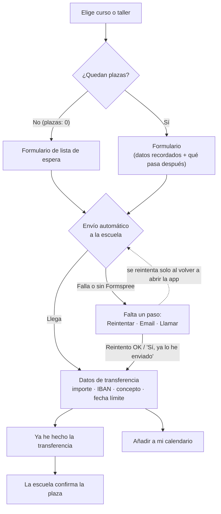

# App de Obrador Mi Segueta

App de la escuela de joyería Obrador Mi Segueta (Palma): cursos, talleres en calendario, precios, reserva de plaza con pago por transferencia y horario de apertura. Funciona en móvil y ordenador, y se puede "instalar" en el móvil como una app.

## Cómo cambiar los datos

Todo se edita en **`datos.js`** (no hace falta tocar nada más):

- **ESCUELA**: nombre, dirección, teléfono, email, horario, **datos bancarios (IBAN)**, plazo de confirmación (`plazoConfirmacion`) y **política de cambios y cancelaciones** (`politicaCancelacion`).
- **CURSOS**: nombre, descripción, nivel, fecha de inicio, horario, precio, plazas y foto.
- **TALLERES**: nombre, descripción, fecha (`AAAA-MM-DD`), hora, precio, plazas y foto. Aparecen solos en el calendario.

**Fotos:** están en la carpeta `fotos/`. Las de ahora son **fotos de ejemplo** de Unsplash (uso libre; ver `fotos/CREDITOS.txt`). Cámbialas por fotos de vuestras piezas: guarda la nueva con el mismo nombre, o cambia `foto` y `fotoAlt` (la descripción para quien no ve la imagen) en `datos.js`.

## Cómo funciona la reserva

1. El alumno pulsa **Reservar**. El formulario ya trae su nombre, email y teléfono si reservó antes, avisa si ya tiene una reserva de lo mismo y explica en 3 líneas **qué pasará después**. Los errores (email mal escrito, teléfono corto) se señalan junto al campo.
2. Al pulsar **Enviar reserva**, la app la manda **sola** a la escuela con Formspree (el botón muestra "Enviando…" y no se puede pulsar dos veces).
   - Si llega: pasa directamente a los datos de pago.
   - Si no llega (sin conexión, o sin Formspree configurado): se lo dice claramente y le da 3 salidas: **Reintentar**, **Enviar por email** o **Llamar**. Si usa el email, la app le pregunta si de verdad lo envió antes de darlo por hecho. Además, la app **reintenta sola** al volver a abrirse o al recuperar conexión.
3. **Transferencia**: importe, IBAN y concepto con botón Copiar, y una fecha límite que nunca cae después de la víspera de la actividad. Botón **Ya he hecho la transferencia** y **Añadir a mi calendario** (con aviso el día antes).
4. **Mis reservas** muestra una barra de progreso (Enviada → Transferencia → Confirmada), pone primero lo que tiene algo pendiente, avisa si el plazo de pago ha vencido y marca como *Finalizada* lo que ya pasó.
5. **Curso o taller lleno**: pon `plazas: 0` en `datos.js` y aparece "Completo" con un botón de **lista de espera** (no se pide pago).

### Para que funcione de verdad (lista de la escuela)

- [ ] Poner en `datos.js` el **IBAN, banco y teléfono reales**.
- [ ] Poner en `datos.js` el **titular legal y el NIF** (`titularLegal`, `nif`): salen en la página de privacidad (`privacidad.html`).
- [ ] En cada email de confirmación, **repetir el IBAN** de la escuela, para que el alumno pueda comprobar que es el mismo (ver `AUDITORIA-SEGURIDAD.md`).
- [ ] Crear un formulario gratis en [Formspree](https://formspree.io), copiar su dirección (`https://formspree.io/f/...`) en `formularioURL` y hacer una reserva de prueba (la primera vez Formspree pide confirmar tu email).
- [ ] Cuando llegue una transferencia, buscar el **concepto** (`MSG-XXXXX Nombre`) en los emails de reservas y contestar al alumno confirmando la plaza (al responder, el email va directo a él).
- [ ] Cuando se llene un curso o taller, cambiar sus `plazas` a `0`.

Mientras falte algo, al abrir la app **en tu ordenador** verás una franja amarilla "Modo prueba" que dice qué falta. Los alumnos no la ven.

> La app no lleva la cuenta de plazas libres automáticamente: la escuela controla el aforo con las reservas que le llegan.

## Publicarla gratis en internet

En GitHub: **Settings → Pages → Branch: `main` → Save**. En un par de minutos estará en
`https://andreafarriol68-droid.github.io/app/`, y puedes enlazarla desde tu página web.

- **Sin conexión:** una vez abierta, la app queda guardada en el móvil (`sw.js`) y se abre aunque no haya internet. Las reservas se envían cuando vuelve la conexión.
- **Al compartir el enlace** (WhatsApp, Instagram…) sale una vista previa con la foto de `fotos/iniciacion.jpg`. Si la publicas en otra dirección, cambia `og:url` y `og:image` en `index.html`.
- **Si añades una foto con un nombre nuevo**, ponla también en la lista de `sw.js` y sube el número de `VERSION`.
- **Seguridad:** las fuentes están en `fuentes/` y la página solo carga archivos propios (regla `Content-Security-Policy` en `index.html`). Si algún día añades algo de otra web (un mapa, un vídeo, otro servicio de formularios), hay que añadir su dirección a esa regla o el navegador lo bloqueará. Más detalles en `AUDITORIA-SEGURIDAD.md`.
