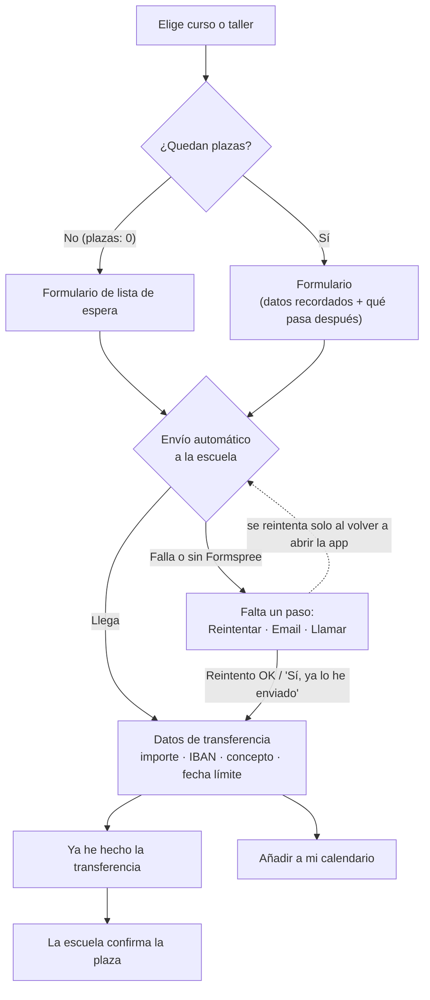

# App de Obrador Mi Segueta

App de la escuela de joyería Obrador Mi Segueta (Palma): cursos, talleres en calendario, precios, reserva de plaza con pago por transferencia y horario de apertura. Funciona en móvil y ordenador, y se puede "instalar" en el móvil como una app.

## Cómo cambiar los datos

Con Supabase conectado, cursos, talleres y textos se editan desde la **intranet** (ver más abajo) y `datos.js` queda como copia de reserva; el **IBAN** se cambia siempre en `datos.js`. Sin Supabase, todo se edita en **`datos.js`** (no hace falta tocar nada más):

- **ESCUELA**: nombre, dirección, teléfono, email, horario, **datos bancarios (IBAN)**, plazo de confirmación (`plazoConfirmacion`) y **política de cambios y cancelaciones** (`politicaCancelacion`).
- **CURSOS**: nombre, descripción, nivel, fecha de inicio, horario, precio, plazas y foto.
- **TALLERES**: nombre, descripción, fecha (`AAAA-MM-DD`), hora, precio, plazas y foto. Aparecen solos en el calendario.

**Fotos:** están en la carpeta `fotos/`. Las de ahora son **fotos de ejemplo** de Unsplash (uso libre; ver `fotos/CREDITOS.txt`). Cámbialas por fotos de vuestras piezas: guarda la nueva con el mismo nombre, o cambia `foto` y `fotoAlt` (la descripción para quien no ve la imagen) en `datos.js`.

## Cómo funciona la reserva



1. El alumno pulsa **Reservar**. El formulario ya trae su nombre, email y teléfono si reservó antes, avisa si ya tiene una reserva de lo mismo y explica en 3 líneas **qué pasará después**. Los errores (email mal escrito, teléfono corto) se señalan junto al campo.
2. Al pulsar **Enviar reserva**, la app la manda **sola** a la escuela con Formspree (el botón muestra "Enviando…" y no se puede pulsar dos veces).
   - Si llega: pasa directamente a los datos de pago.
   - Si no llega (sin conexión, o sin Formspree configurado): se lo dice claramente y le da 3 salidas: **Reintentar**, **Enviar por email** o **Llamar**. Si usa el email, la app le pregunta si de verdad lo envió antes de darlo por hecho. Además, la app **reintenta sola** al volver a abrirse o al recuperar conexión.
3. **Transferencia**: importe, IBAN y concepto con botón Copiar, y una fecha límite que nunca cae después de la víspera de la actividad. Botón **Ya he hecho la transferencia** y **Añadir a mi calendario** (con aviso el día antes).
4. **Mis reservas** muestra una barra de progreso (Enviada → Transferencia → Confirmada), pone primero lo que tiene algo pendiente, avisa si el plazo de pago ha vencido y marca como *Finalizada* lo que ya pasó.
5. **Curso o taller lleno**: pon `plazas: 0` en `datos.js` y aparece "Completo" con un botón de **lista de espera** (no se pide pago).

### Para que funcione de verdad (lista de la escuela)

- [ ] Poner en `datos.js` el **IBAN, banco y teléfono reales**.
- [ ] Poner en `datos.js` el **titular legal y el NIF** (`titularLegal`, `nif`): salen en la página de privacidad (`privacidad.html`).
- [ ] En cada email de confirmación, **repetir el IBAN** de la escuela, para que el alumno pueda comprobar que es el mismo (ver `AUDITORIA-SEGURIDAD.md`).
- [ ] Crear un formulario gratis en [Formspree](https://formspree.io), copiar su dirección (`https://formspree.io/f/...`) en `formularioURL` y hacer una reserva de prueba (la primera vez Formspree pide confirmar tu email).
- [ ] Cuando llegue una transferencia, buscar el **concepto** (`MSG-XXXXX Nombre`) en los emails de reservas y contestar al alumno confirmando la plaza (al responder, el email va directo a él).
- [ ] Cuando se llene un curso o taller, cambiar sus `plazas` a `0`.

Mientras falte algo, al abrir la app **en tu ordenador** verás una franja amarilla "Modo prueba" que dice qué falta. Los alumnos no la ven.

> La app no lleva la cuenta de plazas libres automáticamente: la escuela controla el aforo con las reservas que le llegan.

## Cuentas de usuario e intranet (Supabase)

La web se conecta con [Supabase](https://supabase.com) (proyecto `sjzjneckpkwvgxrtdcgo`) para tres cosas:

- **Cuentas** (`cuenta.html`, botón *Entrar* arriba a la derecha): registro con nombre de usuario, email y contraseña; entrar con email **o** usuario; recuperar la contraseña; ver el estado de tus reservas; borrar la cuenta.
- **Intranet** (carpeta `intranet/`, una **app aparte** de la web, solo para el rol *administración*; ver más abajo):
  - **Reservas**: todas las que llegan desde la web, con filtros y buscador. Se cambia el estado (*Pendiente de pago → Pagada → Confirmada*, o *Cancelada*) y el alumno lo ve en su app. Botón *Escribir al alumno* con el email ya redactado (incluye el IBAN de `intranet/config.js`).
  - **Cursos y talleres**: crear, editar, ocultar y borrar. Se ve en la web al momento.
  - **Datos de la escuela**: textos, contacto, horario y política de cancelación.
  - **Usuarios**: lista de cuentas y dar o quitar el rol de administración.
- **Reservas automáticas**: cada reserva se guarda en la intranet (además de Formspree, si está puesto).

### Ponerla en marcha (una sola vez)

1. **Clave pública**: en Supabase → *Project Settings → API Keys*, copia la clave **publishable** (o la *anon public*) y pégala en `datos.js` → `SUPABASE.clave` **y** en `intranet/config.js` → `SUPABASE.clave`. **Nunca** pongas la *secret* / *service_role*.
2. **Base de datos**: Supabase → *SQL Editor → New query*, pega todo `supabase/esquema.sql` y pulsa *Run*. Crea las tablas, las reglas de seguridad y copia los cursos y talleres actuales.
3. **Emails de confirmación**: Supabase → *Authentication → URL Configuration*: en *Site URL* pon la dirección de la web (p. ej. `https://andreafarriol68-droid.github.io/app/`) y en *Redirect URLs* añade `https://andreafarriol68-droid.github.io/app/cuenta.html`, la dirección de la intranet (p. ej. `https://intranet-misegueta.pages.dev/`) y, para probar, `http://localhost:8137/cuenta.html` y `http://localhost:8139/`.
4. **Contraseñas**: *Authentication → Providers → Email* (o *Policies*): longitud mínima **8** y, si está disponible, *leaked password protection*.
5. **Primer administrador**: regístrate en `cuenta.html` de la web, confirma el email y ejecuta en el SQL Editor (con tu usuario):
   `update public.perfiles set rol = 'admin' where usuario = 'tu_usuario';`
   Desde ahí, los demás roles se dan en *Intranet → Usuarios*.

**Seguridad:** quien decide lo que se puede hacer es la base de datos (reglas RLS de `supabase/esquema.sql`), no la página: aunque alguien copie la clave pública, sin rol de administración no puede leer reservas ajenas ni cambiar nada. El **IBAN no se puede cambiar desde la intranet** a propósito (ver `AUDITORIA-SEGURIDAD.md`, A1). Si se pierde la conexión con Supabase, la web sigue funcionando con lo último descargado o, si no, con `datos.js`.

### La intranet: una app aparte

La intranet está en la carpeta **`intranet/`** y no comparte nada con la web pública: tiene su propia página, estilos, fuentes, inicio de sesión y configuración (`intranet/config.js`). La web no la enlaza ni la guarda en el móvil, y GitHub Pages no la publica (`_config.yml`).

- **Entrar**: con el email o el usuario y la contraseña de una cuenta con rol de administración. Si una cuenta sin ese rol intenta entrar, se cierra la sesión al momento. Se cierra sola tras **30 minutos** sin usarla (`MINUTOS_INACTIVIDAD`).
- **Publicarla** en su propia dirección, para que tenga un *origen* distinto de la web (así nada de la web pública puede tocar la sesión de la intranet). Lo más sencillo y gratis: [Cloudflare Pages](https://pages.cloudflare.com) → *Create → Upload assets* → arrastra la carpeta `intranet/`. Te da una dirección tipo `https://intranet-misegueta.pages.dev`. Las cabeceras de seguridad del archivo `intranet/_headers` se aplican solas (también en Netlify). Con dominio propio, mejor `intranet.obradormisegueta.es`.
- Después de publicarla, añade su dirección en Supabase → *Redirect URLs* (para los emails de nueva contraseña). Si la publicas en otro sitio, revisa en `intranet/config.js` la dirección de la web (`WEB_PUBLICA`) y, si cambia el dominio de la web, también `img-src` en `intranet/index.html` y `intranet/_headers`.
- **Mantener**: `intranet/supa.js` es una copia exacta de `supa.js`; si cambias uno, copia el otro. El IBAN de `intranet/config.js` (el que sale en los emails a los alumnos) tiene que ser **el mismo** que el de `datos.js`.
- **Probarla en tu ordenador**: sirve la carpeta `intranet/` en `http://localhost:8139`.

## Chatbot (asistente de dudas)

Botón **«¿Dudas?»** abajo a la derecha de la web. Responde con IA (Claude, de Anthropic) sobre cursos, talleres, precios, fechas, horario y cómo reservar, usando **los mismos datos que la intranet** (si cambias un precio en la intranet, el chatbot lo sabe en 5 minutos). No da nunca el IBAN, no hace reservas y no pide datos personales.

**Sin Supabase también funciona**: si Supabase no está conectado, si no hay internet o si Claude falla, responde un asistente sencillo (`asistente.js`) que no usa IA ni envía nada: busca palabras clave en la pregunta y contesta con los datos de `datos.js` (o los de la intranet). Entiende preguntas sobre cursos y talleres concretos, precios, plazas, fechas («¿qué hay en noviembre?»), horario, dirección, reservas, pago, cancelaciones, regalos y alianzas. Si no sabe algo, da el teléfono y el email. Para que entienda una palabra nueva, añádela a su tema en la lista `TEMAS` de `asistente.js`.

La clave de Anthropic **no está en la web**: vive en una función de Supabase (`supabase/functions/chat/index.ts`), que es la que habla con Claude.

### Ponerlo en marcha (una sola vez)

1. Crea una clave en [platform.claude.com](https://platform.claude.com) → *API Keys*, y pon un **límite de gasto mensual** en *Billing → Limits* (p. ej. 10 €), así nunca te llevas sorpresas.
2. Instala la [herramienta de Supabase](https://supabase.com/docs/guides/cli) y, en esta carpeta:

   ```bash
   supabase login
   supabase link --project-ref sjzjneckpkwvgxrtdcgo
   supabase secrets set ANTHROPIC_API_KEY=sk-ant-...
   supabase secrets set ORIGENES_PERMITIDOS=https://andreafarriol68-droid.github.io,http://localhost:8137
   supabase functions deploy chat --no-verify-jwt
   ```

   `ORIGENES_PERMITIDOS` son las webs que pueden usar el chat (para que otra página no gaste tu saldo); si cambias de dominio, añádelo. `--no-verify-jwt` es porque lo usan visitantes sin cuenta.
3. Abre la web y pregunta algo. Si falla, mira los errores en Supabase → *Edge Functions → chat → Logs*.

**Coste:** usa Claude Opus 5.5 con razonamiento bajo; cada pregunta cuesta del orden de 1-2 céntimos (mirad el gasto real en la consola de Anthropic las primeras semanas). Si quieres que sea más barato, cambia `MODELO` en `supabase/functions/chat/index.ts` a `claude-haiku-5-5` (unas 40 veces más barato, algo menos fino) y vuelve a desplegar. Hay un freno de 8 mensajes por minuto por persona.

## Publicarla gratis en internet

En GitHub: **Settings → Pages → Branch: `main` → Save**. En un par de minutos estará en
`https://andreafarriol68-droid.github.io/app/`, y puedes enlazarla desde tu página web.

- **Sin conexión:** una vez abierta, la app queda guardada en el móvil (`sw.js`) y se abre aunque no haya internet. Las reservas se envían cuando vuelve la conexión.
- **Al compartir el enlace** (WhatsApp, Instagram…) sale una vista previa con la foto de `fotos/iniciacion.jpg`. Si la publicas en otra dirección, cambia `og:url` y `og:image` en `index.html`.
- **Si añades una foto con un nombre nuevo**, ponla también en la lista de `sw.js` y sube el número de `VERSION`.
- **Seguridad:** las fuentes están en `fuentes/` y la página solo carga archivos propios (regla `Content-Security-Policy` en `index.html`). Si algún día añades algo de otra web (un mapa, un vídeo, otro servicio de formularios), hay que añadir su dirección a esa regla o el navegador lo bloqueará. Más detalles en `AUDITORIA-SEGURIDAD.md`.
